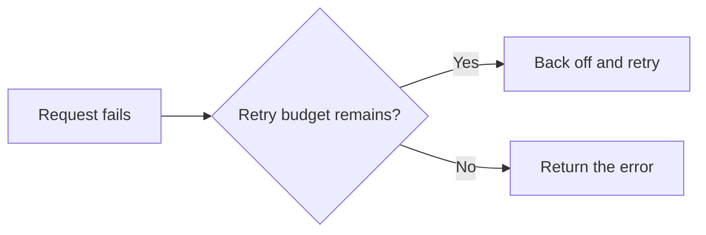

# Calypso

Calypso is a terminal workflow for turning podcast recordings into vertical short clips. It includes a repository-local Codex skill and a Python CLI. Codex reviews the transcript and drafts suggestions. The CLI handles local transcription, listing candidates, diagrams, and rendering.

For a guided run, open Codex in this repository and say `Use $calypso-podcast-clips to walk me through making clips from /path/to/episode.mp4.`

## Setup

Install Python 3.9+, FFmpeg 8 with `libx264` and AAC, and [whisper.cpp](https://github.com/ggml-org/whisper.cpp). For Excalidraw diagrams, also install Node.js 22+, a browser supported by the [Excalidraw CLI](https://github.com/excalidraw/cli), and `@excalidraw/cli`. All commands assume you are at the repository root.

On macOS with Homebrew:

```sh
brew install python ffmpeg whisper-cpp
# If needed for diagrams, install Node.js 22+ and a supported browser first.
npm install -g @excalidraw/cli
```

On Linux, install Python and a suitable FFmpeg build with your package manager or from [FFmpeg](https://ffmpeg.org/download.html). Build and install `whisper-cli` using the [upstream instructions](https://github.com/ggml-org/whisper.cpp#quick-start) and put it on your PATH. The Python CLI has no pip dependencies.

Download a [Whisper GGML model](https://huggingface.co/ggerganov/whisper.cpp) once. For example:

```sh
mkdir -p models
curl -fL https://huggingface.co/ggerganov/whisper.cpp/resolve/main/ggml-base.bin -o models/ggml-base.bin
export CALYPSO_WHISPER_MODEL="$PWD/models/ggml-base.bin"
./scripts/calypso.py doctor
```

The model can also be passed with `--model`. Transcription runs on your machine. If you ask Codex to analyze the transcript, its text is processed by the model configured in Codex.

## Transcribe and select

```sh
./scripts/calypso.py transcribe /path/to/episode.mp4 work/episode --language en
```

Choose a new work directory each time. The command writes `dialogue.wav`, `transcript.json`, and `transcript.srt`. Omit `--language` for auto-detection with a multilingual model. Use `--audio-track 1` to select the second audio stream when necessary.

Start Codex in the repository and use `$calypso-podcast-clips` to analyze the transcript and propose clips. The skill is under `.agents/skills/` and travels with the checkout. You can also write the plan by hand. Save it as `work/episode/clips.json`:

```json
{
  "clips": [
    {
      "id": "retry-budget",
      "start": 92.4,
      "end": 124.1,
      "title": "Why retries need a budget",
      "reason": "The explanation includes a failure case, a design rule, and a concrete example."
    }
  ]
}
```

```sh
./scripts/calypso.py list work/episode/clips.json
./scripts/calypso.py render /path/to/episode.mp4 work/episode/clips.json retry-budget work/episode/original.mp4
```

Run `render` once per selected ID. Give each export a new path in an existing directory. The `original` layout preserves the full frame inside a 1080×1920 canvas. Outputs are H.264/AAC MP4 with fast start. Specify `--audio-track` on render if the first audio stream is unsuitable.

## Crop to the speaker

For a fixed two-person shot, save a framing file with even pixel coordinates in `[x, y, width, height]` order. Use sorted, nonoverlapping turns in source-relative seconds. A gap shows the full shot and can represent crosstalk or uncertain attribution.

```json
{
  "crops": {
    "left": [0, 0, 960, 1080],
    "right": [960, 0, 960, 1080]
  },
  "turns": [
    {"start": 92.4, "end": 109.0, "speaker": "left"},
    {"start": 109.4, "end": 124.1, "speaker": "right"}
  ]
}
```

```sh
./scripts/calypso.py render /path/to/episode.mp4 work/episode/clips.json retry-budget \
  work/episode/speaker.mp4 --layout speaker --framing work/episode/framing.json
```

Derive the turns from the recording or a diarization tool, then map each speaker label to a seat. The renderer applies those decisions and keeps the audio continuous. For moving subjects or changing camera layouts, automatic face tracking would require an additional integration.

## Add a block diagram

Write a Mermaid flowchart in a `.mmd` file, for example:



```sh
./scripts/calypso.py diagram work/episode/retries.mmd work/episode/retries.png
./scripts/calypso.py render /path/to/episode.mp4 work/episode/clips.json retry-budget \
  work/episode/diagram.mp4 --layout diagram --diagram work/episode/retries.png
./scripts/calypso.py render /path/to/episode.mp4 work/episode/clips.json retry-budget \
  work/episode/combined.mp4 --layout combined --diagram work/episode/retries.png \
  --framing work/episode/framing.json
```

The diagram command saves an editable `.excalidraw` file alongside the PNG when given Mermaid input. It also accepts an existing `.excalidraw` file. The diagram stays onscreen for the selected clip. For the combined layout, omitting `--framing` shows the full shot above the diagram.

Run `./scripts/smoke-test.sh` to check the four export layouts with generated media. The check requires Python and FFmpeg.
